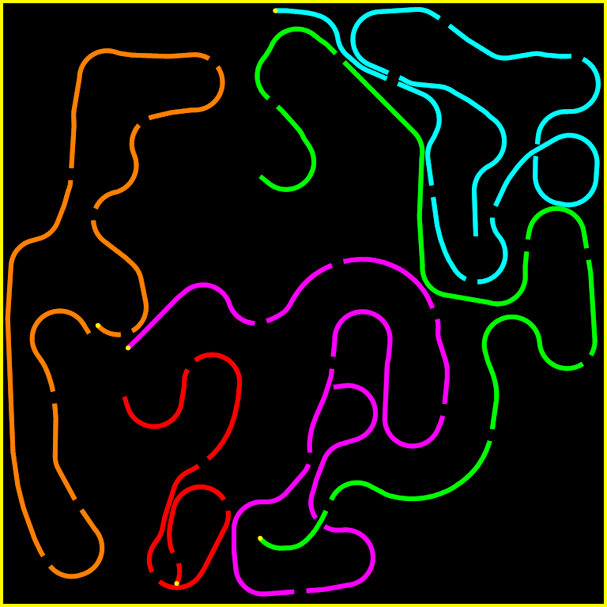

# Curve Fever Classic – Achtung, die Kurve! in HTML5

**▶ Play now: https://eliasfloreteng.github.io/curve-fever/**

A faithful, open-source remake of the **Curve Fever 1** Flash game (2010), itself a remake of the
1995 DOS classic **Achtung, die Kurve!** (Zatacka). Up to 6 players steer their curves on one
keyboard. Avoid the walls and every line, slip through the holes, and outlive everyone else.
It runs in any modern browser, with no Flash, plugins or downloads.



## How to play

1. Click a player's name (or press 1–6) and press the keys for left and right.
2. Add at least two players, or click **CPU** to add computer opponents.
3. Pick **Arcade** (with powerups) or **Classic** (no powerups).
4. Press **Space** to play. Space also starts each round and pauses; **Esc** goes back to the menu.

Each time a curve crashes, everyone still alive gets a point. The goal is 10 points per
opponent, and you have to win by 2.

## Faithful to the original

The rules and numbers come from the original game's code: speed (90 px/s), turning radius
(35 px), line width, how often holes appear and how long they are, the 15 powerups with their
spawn rates and durations, scoring with the 2-point lead, and the computer player's look-ahead AI.

## Improvements

- Smooth 100 Hz simulation instead of 25 fps, with the same speeds and turning circle
- Computer players can take any seat, alongside humans
- Players, keys and settings are remembered
- Fullscreen (F), touch controls against the computer, offline play (PWA)
- No ads, and no clashing key assignments
- Music and sound effects are synthesised in the browser

## Development

Plain HTML, CSS and JavaScript modules. No build step:

```sh
python3 -m http.server
# open http://localhost:8000
```

| File | What it does |
| --- | --- |
| `js/config.js` | Constants from the original: physics, players, powerups |
| `js/engine.js` | Simulation, collision grid, powerups, computer AI |
| `js/render.js` | Canvas rendering |
| `js/audio.js` | Synthesised sound effects and music |
| `js/main.js` | Menu, key binding, rounds and input |

## Credits

Inspired by the archived Flash original in [gameyoga/Curve-Fever-1](https://github.com/gameyoga/Curve-Fever-1).
The original Curve Fever was developed by Geert. This is an unofficial fan project, not affiliated
with Curve Fever or [Curve Fever Pro](https://curvefever.pro). All code is new; no original assets are included.

## License

[MIT](LICENSE)
